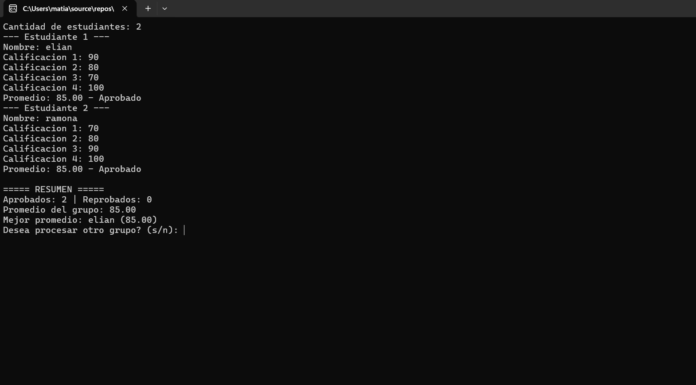
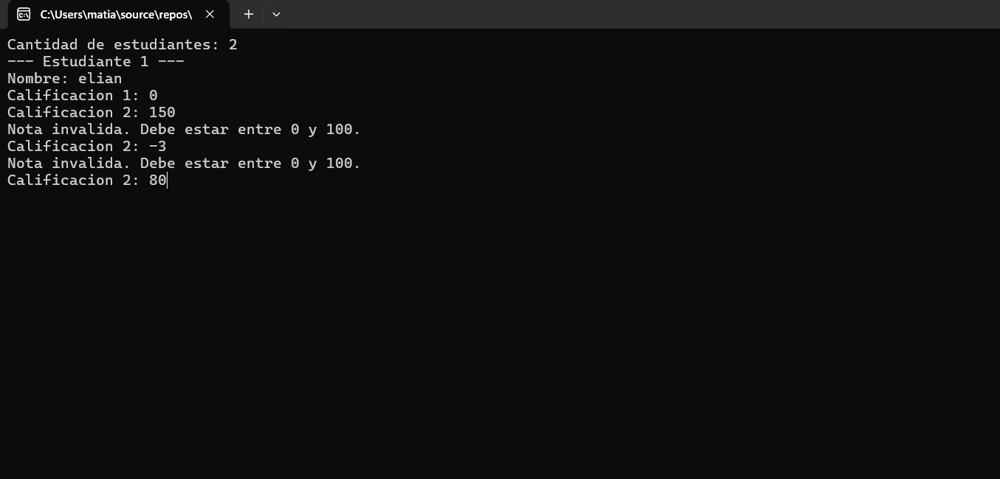
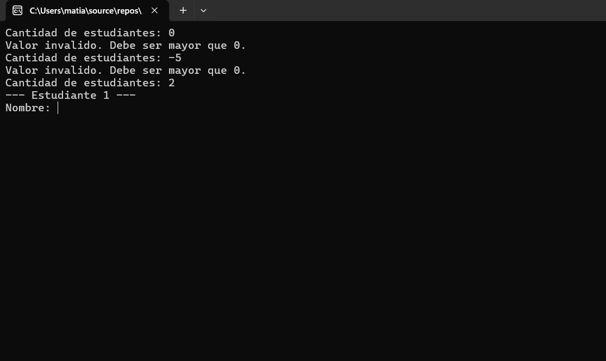
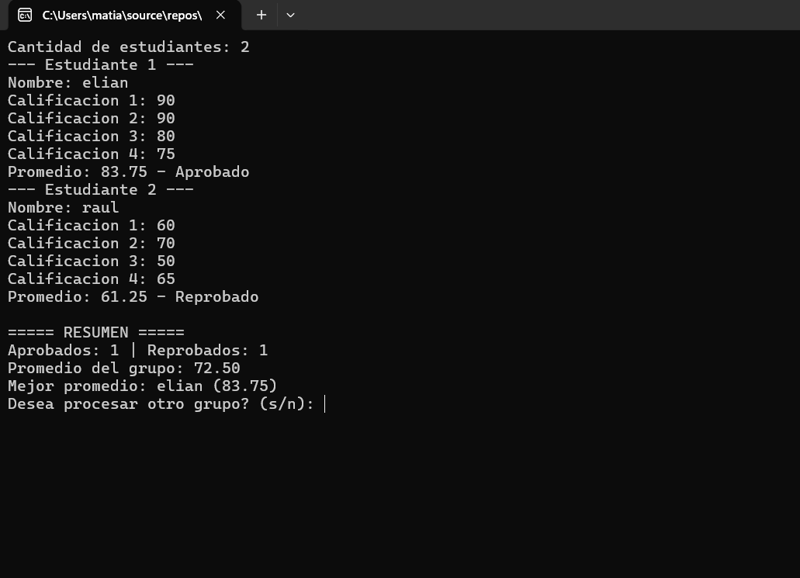
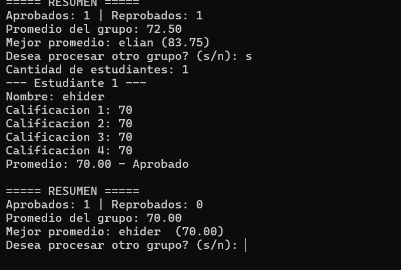

1E-control-calificaciones-cpp

## Presentacion

**Nombre:**EHIDER ELIAN FELIX MATIAS

**Matrícula:**2026-1412

**Asignatura:**Lógica de Programación

**Profesor:**Gamalier Reyes del Carmen

Descripción del programa

Este programa en c++ ayuda a calificar y calcular las notas de estudiantes ya dependiendo
de cuantos estudiantes decidas califica, puedes agregar el nombre del estudiante
y agg las calificaciones, te muestra el promedio que saco el estudiante y si aprobo oh reprobo
si quieres agregar mas solo elijes la tecla ¨s¨

## Datos de entrada

El usuario ingresa los siguientes datos:

1. La cantidad de estudiantes del grupo, que debe ser mayor que 0. Si no lo es, el programa la vuelve a pedir.
2. El nombre de cada estudiante (se pide una vez por cada estudiante).
3. Las 4 calificaciones de cada estudiante, que deben estar entre 0 y 100. Si una está fuera de ese rango, el programa la vuelve a pedir.
4. Al final, la respuesta `s` o `n` para decidir si se procesa otro grupo.

   ## Proceso

1. El programa valida la cantidad de estudiantes con un bucle `do-while`, que repite la pregunta hasta que el valor sea mayor que 0.
2. Con un bucle `for` recorre a cada estudiante: pide el nombre y reinicia en 0 la variable `sumaNotas`.
3. Con otro bucle `for` pide las 4 calificaciones. Cada una se valida con un `do-while` que repite la petición mientras la nota esté fuera del rango 0 a 100. Las notas válidas se acumulan en `sumaNotas`.
4. Calcula el promedio del estudiante dividiendo `sumaNotas` entre 4. Si el promedio es 70 o más, lo marca como Aprobado y suma 1 al contador `aprobados`. Si no, lo marca como Reprobado y suma 1 a `reprobados`.
5. Suma el promedio de cada estudiante en el acumulador `sumaPromedios`.
6. Compara el promedio con `mejorPromedio`. Si es mayor, guarda ese promedio y el nombre del estudiante en `mejorNombre`.
7. Al terminar el grupo, calcula el promedio del grupo dividiendo `sumaPromedios` entre la cantidad de estudiantes y muestra el resumen.
8. Pregunta si se desea procesar otro grupo. Si la respuesta es `s`, se repite todo desde el paso 1.

   ## Salida

Por cada estudiante, el programa muestra su promedio con dos decimales y si está Aprobado o Reprobado. Al terminar el grupo muestra un resumen con:

- La cantidad de estudiantes aprobados y reprobados.
- El promedio general del grupo.
- El nombre y el promedio del estudiante con el promedio más alto.

Por último, pregunta si se desea procesar otro grupo (s/n).

## Capturas de pantalla

### Grupo normal

### Validación de calificaciones

### Validación de la cantidad de estudiantes

### Aprobado y reprobado

### Repetir el programa con otro grupo

